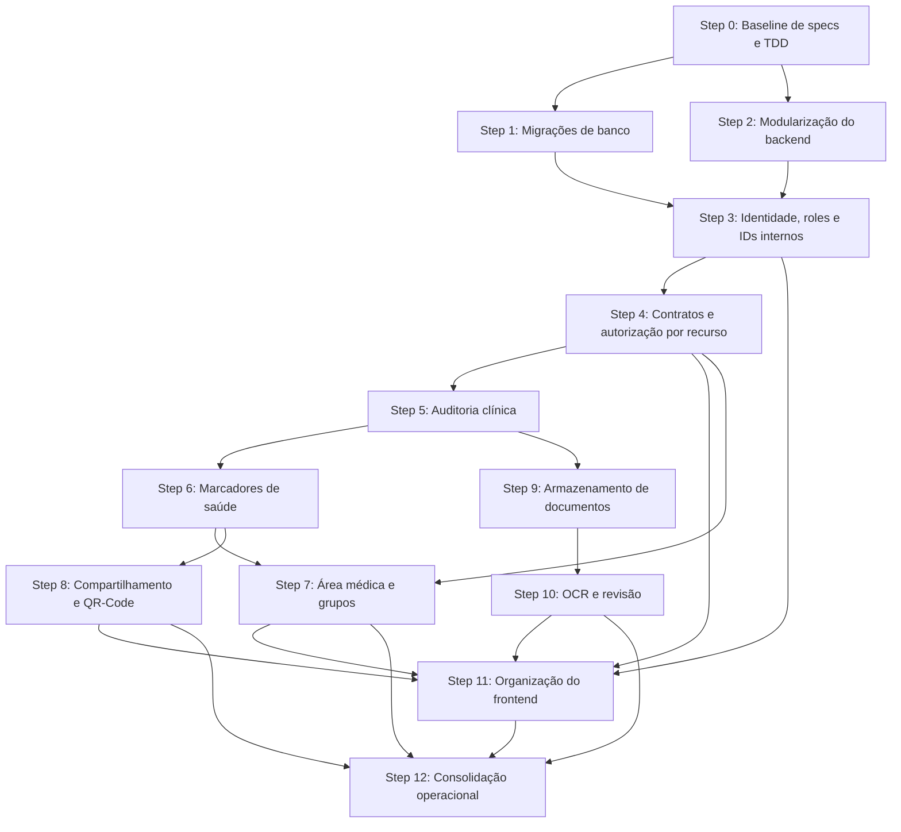

# Plano de Evolução Arquitetural

## Objetivo

Preparar o Documento Unificado de Saúde para marcadores clínicos, área médica,
compartilhamento por QR-Code e documentos com OCR sem transformar o projeto em
uma arquitetura maior do que o problema atual exige.

Este documento é o tracker interno do plano. As funcionalidades somente podem
entrar em implementação depois que sua spec estiver escrita e revisada.

## Premissas

- A aplicação continuará como um monólito modular.
- O banco atual contém dados de demonstração. Se essa premissa mudar, o plano de
  migração deverá ser revisado antes do Step 1.
- SQL explícito e `mysql-connector` serão mantidos no backend enquanto atenderem
  ao projeto; Alembic e SQLAlchemy serão usados na infraestrutura de migrations.
- Não serão introduzidos microserviços, Redis, filas externas, event sourcing ou
  ORM sem uma necessidade comprovada por uma spec.
- Backend, frontend, banco e testes fazem parte da mesma entrega vertical.

## Princípios obrigatórios

### Spec-driven development

Toda mudança de comportamento começa em uma spec versionada em `docs/specs/`.
Cada spec deve conter:

- contexto e problema;
- histórias e regras de negócio;
- cenários de aceitação em Given/When/Then;
- contratos de API e dados afetados;
- requisitos de segurança e autorização;
- casos de erro e limites;
- não objetivos;
- estratégia de testes;
- dependências e critérios de conclusão.

Se a implementação revelar uma regra nova, a spec deve ser atualizada antes do
código correspondente.

### Strict TDD

O ciclo obrigatório para cada comportamento é:

1. **RED:** escrever o menor teste que expresse um cenário da spec e confirmar
   que ele falha pela razão esperada.
2. **GREEN:** implementar apenas o necessário para o teste passar.
3. **REFACTOR:** melhorar nomes, remover duplicação e ajustar responsabilidades
   mantendo toda a suíte verde.
4. Executar os testes afetados e os testes de regressão relevantes.

Código de produção não deve ser escrito antes de existir um teste falhando para
o comportamento, incluindo autorização, migrações e tratamento de erros.

### DRY

- Remover duplicação real e estável.
- Não criar abstrações para uma única ocorrência ou para uma necessidade futura
  hipotética.
- Preferir duplicação pequena e explícita a uma abstração prematura difícil de
  entender.

### Keep It Simple

- Preferir SQL, funções e módulos explícitos.
- Adicionar uma camada somente quando ela possuir responsabilidade concreta.
- Entregar a menor fatia vertical que satisfaça a spec.

### SOLID

- Cada módulo deve ter uma responsabilidade clara.
- Regras clínicas devem ser testáveis sem depender da camada HTTP.
- Dependências externas, como armazenamento e OCR, devem ficar atrás de
  contratos pequenos apenas quando houver mais de uma implementação ou quando o
  isolamento for necessário para testes.
- Não criar interfaces vazias ou hierarquias apenas para afirmar aderência ao
  SOLID.

### No overengineering

- Não implementar requisitos que não estejam em uma spec aprovada.
- Não preparar infraestrutura sem consumidor imediato.
- Toda nova dependência deve resolver um problema atual e documentado.

### Entrega vertical e coerência do frontend

- Uma entrega de backend não é considerada encerrada sem uma revisão explícita
  do impacto nos fluxos e contratos consumidos pelo frontend.
- A revisão ocorre depois que o backend está verde e antes da Definition of Done;
  seu resultado é registrado na spec ou na descrição do PR, inclusive quando a
  conclusão for "sem alteração de frontend".
- Quando houver impacto, a mesma entrega atualiza estados, contratos, testes e a
  experiência da interface antes de ser marcada como `DONE`.
- Componentes tocados não podem manter ou reproduzir padrões visuais legados.
  Devem seguir a direção visual vigente em
  `docs/specs/003-unified-identity-roles-frontend.md`, incluindo modais,
  formulários, feedback, loading, vazio e erro.
- A modernização fica limitada ao fluxo afetado; superfícies sem relação com a
  entrega permanecem no Step 11 para evitar redesign não planejado.

## Workflow de cada entrega

1. Selecionar uma tarefa desbloqueada neste plano.
2. Criar ou atualizar sua spec em `docs/specs/`.
3. Revisar a spec, contratos, riscos e não objetivos.
4. Marcar a tarefa como `SPEC APPROVED` neste documento.
5. Executar o ciclo RED, GREEN e REFACTOR em incrementos pequenos.
6. Ao concluir o backend, revisar e registrar o impacto no frontend.
7. Se houver impacto, atualizar a spec antes do comportamento correspondente e
   executar o ciclo RED, GREEN e REFACTOR do frontend.
8. Atualizar documentação e exemplos de ambiente.
9. Executar a Definition of Done.
10. Atualizar status, PR/commit e observações neste tracker.

## Status utilizados

- `PLANNED`: aguardando início.
- `SPEC WRITING`: spec em elaboração.
- `SPEC REVIEW`: aguardando revisão.
- `SPEC APPROVED`: pronta para TDD.
- `IN PROGRESS`: implementação em RED/GREEN/REFACTOR.
- `BLOCKED`: dependência ou decisão pendente registrada.
- `DONE`: Definition of Done atendida.

## Árvore de dependências

### Leitura da árvore

- Steps 1 e 2 podem ocorrer em paralelo depois do baseline.
- Identidade depende de banco evolutivo e módulos técnicos separados.
- Auditoria vem antes das features clínicas para evitar dados sem autoria.
- Área médica depende de autorização e marcadores.
- QR-Code depende do resumo clínico fornecido pelos marcadores.
- OCR depende primeiro do armazenamento seguro de documentos.
- A organização do frontend começa após identidade e contratos, mas suas telas
  são concluídas incrementalmente com cada feature.
- O Step 12 consolida o que já foi testado em cada step; testes não são adiados
  para o final.

## Tracker geral

| Step | Entrega | Dependências | Status | Referência |
|---|---|---|---|---|
| 0 | Baseline de specs e TDD | — | DONE | Primeiro ciclo TDD registrado na spec `001` |
| 1 | Migrações de banco | 0 | DONE | [PR #1](https://github.com/PedronSol/Documento-Unificado-De-Saude/pull/1) |
| 2 | Modularização do backend | 0 | DONE | [PR #2](https://github.com/PedronSol/Documento-Unificado-De-Saude/pull/2) |
| 3 | Identidade, roles e IDs internos | 1, 2 | DONE | [PR #3](https://github.com/PedronSol/Documento-Unificado-De-Saude/pull/3) |
| 4 | Contratos e autorização por recurso | 3 | DONE | [PR #4](https://github.com/PedronSol/Documento-Unificado-De-Saude/pull/4) |
| 5 | Auditoria clínica | 4 | DONE | `850e2ad`, `fe56d2a` |
| 6 | Marcadores de saúde | 5 | PLANNED | — |
| 7 | Área médica e grupos | 4, 6 | PLANNED | — |
| 8 | Compartilhamento e QR-Code | 6 | PLANNED | — |
| 9 | Armazenamento de documentos | 5 | PLANNED | — |
| 10 | OCR e revisão | 9 | PLANNED | — |
| 11 | Organização do frontend | 3, 4 e features atendidas | PLANNED | — |
| 12 | Consolidação operacional | 7, 8, 10, 11 | PLANNED | — |

## Step 0 — Baseline de specs e TDD

**Objetivo:** estabelecer a fonte de verdade e comprovar o workflow antes de
alterar a arquitetura.

**Dependências:** nenhuma.

### Tarefas

- [x] Criar `docs/specs/README.md` com o template obrigatório de spec.
- [x] Importar e normalizar o conteúdo de `Features_DUS.txt` para specs
      versionadas no repositório.
- [x] Criar uma spec técnica para migrações de banco.
- [x] Registrar as decisões iniciais: IDs internos, papéis, preservação de dados
      e estratégia de arquivos.
- [x] Confirmar que dados atuais são descartáveis ou escrever plano de backfill.
- [x] Definir como evidenciar RED, GREEN e REFACTOR nas PRs.
- [x] Executar um ciclo TDD pequeno como prova do workflow.

### Critérios de conclusão

- Template de spec revisado.
- Features atuais versionadas dentro do repositório.
- Primeira spec marcada como aprovada.
- Workflow TDD documentado e comprovado.

## Step 1 — Migrações e ciclo de vida do banco

**Objetivo:** evoluir o schema sem apagar dados.

**Dependências:** Step 0.

### Tarefas

- [x] Executar o primeiro ciclo TDD de aplicação e registro da migration inicial.
- [x] Completar testes de aplicação única e ordenada no MySQL real.
- [x] Criar `db/migrations/` e controle de versão `alembic_version`.
- [x] Converter o schema atual na migração inicial.
- [x] Remover `DROP DATABASE` do fluxo normal.
- [x] Mover dados de demonstração para `db/seeds/development.sql`.
- [x] Adotar Alembic com SQLAlchemy restrito à infraestrutura de migrations.
- [x] Injetar configuração, engine e casos de uso no composition root.
- [x] Adicionar `make db-migrate`, `make db-seed` e `make db-reset`.
- [x] Restringir o reset ao ambiente local.
- [x] Integrar migrações ao Compose antes do backend.
- [x] Documentar criação, aplicação e rollback compensatório de migrations.

### Critérios de conclusão

- Banco vazio chega ao schema esperado.
- Segunda execução não reaplica migrations.
- Subir containers não remove dados.
- Testes de migration passam no banco real do Compose.

## Step 2 — Modularização mínima do backend

**Objetivo:** separar infraestrutura e domínios sem mudar comportamento.

**Dependências:** Step 0.

### Tarefas

- [x] Escrever testes de caracterização dos contratos atuais.
- [x] Extrair configuração para `config.py`.
- [x] Extrair conexão e transações para `database.py`.
- [x] Mover autenticação para `auth/`.
- [x] Mover pacientes e vacinas para módulos próprios.
- [x] Registrar módulos com `APIRouter`.
- [x] Remover SQL e regras de negócio de `main.py`.
- [x] Confirmar que respostas HTTP existentes não mudaram.

### Critérios de conclusão

- `main.py` apenas configura a aplicação.
- Não há abstrações genéricas sem consumidor.
- Testes de caracterização permanecem verdes.

## Step 3 — Identidade, roles e IDs internos

**Objetivo:** autenticar uma identidade `User` com uma ou mais `roles` e
refletir os contextos autorizados numa experiência de acesso testável no
frontend.

**Dependências:** Steps 1 e 2.

### Tarefas

- [x] Escrever cenários de login por `role`, `User` inativo e `role`
      incorreta.
- [x] Criar `users` e `user_roles` para `patient`, `doctor` e `admin`.
- [x] Adicionar IDs internos para `patients`.
- [x] Manter CPF obrigatório e único para todo usuário, mas removê-lo das
      chaves estrangeiras e URLs.
- [x] Criar perfil `Doctor` com CRM/UF únicos.
- [x] Migrar `sessions` para `user_id`.
- [x] Migrar relações clínicas para `patient_id`.
- [x] Criar `get_current_user` e dependências de `role`.
- [x] Atualizar seeds e contratos de autenticação com perfis demonstrativos de
      `Patient`, `Doctor` verificado, conta combinada e `Doctor` pendente.
- [x] Cobrir migração e autorização com testes.
- [x] Introduzir Vitest e React Testing Library como suíte unitária do frontend.
- [x] Melhorar o login com semântica acessível e linguagem neutra a `role`.
- [x] Exibir dashboard de paciente ou estado institucional seguro conforme o
      contexto autorizado.
- [x] Cobrir login, erros, sessão e renderização por `role` com testes
      unitários.
- [x] Preservar e ampliar os fluxos Playwright afetados.

### Critérios de conclusão

- [x] `Patient` e `Doctor` compartilham `User` e `Session`.
- [x] Sessões e URLs não dependem de CPF.
- [x] `Role` incorreta retorna `403`.
- [x] Login e home representam o contexto sem tratar o frontend como fonte de
  autorização.
- [x] Testes unitários React, Playwright, build e testes backend passam.

## Step 4 — Contratos e autorização por recurso

**Objetivo:** desacoplar autenticação do dashboard e centralizar ownership.

**Dependências:** Step 3.

### Tarefas

- [x] Escrever matriz de autorização por endpoint.
- [x] Reduzir a resposta de login ao usuário autenticado.
- [x] Fazer `/me` retornar somente identidade e perfil, sem coleções clínicas.
- [x] Manter endpoints separados para vacinas, alertas e documentos; marcadores
      permanecem reservados para o Step 6.
- [x] Reservar rotas médicas sob `/medical`.
- [x] Centralizar ownership dos recursos atuais e definir a política de acesso
      médico por vínculo; a verificação executável entra no Step 7 com seu
      primeiro consumidor.
- [x] Padronizar respostas `401`, `403`, `404`, `409` e `422`.
- [x] Criar testes contra acesso por ID manipulado.

### Critérios de conclusão

- Recursos são carregados independentemente.
- Toda consulta sensível verifica usuário, papel e ownership.
- A matriz de autorização está coberta por testes.

## Step 5 — Auditoria clínica

**Objetivo:** registrar autoria de alterações e acessos sensíveis antes das novas
features clínicas.

**Dependências:** Step 4.

### Tarefas

- [x] Escrever testes para auditoria atômica e sanitização.
- [x] Criar tabela `clinical_audit_events`.
- [x] Registrar ator, paciente, ação, recurso e data.
- [x] Suportar snapshots JSON anteriores e posteriores quando necessários.
- [x] Participar da mesma transação da mudança clínica.
- [x] Proibir senha, token e conteúdo integral de documentos nos logs.
- [x] Definir o padrão de ações para os próximos recursos sem implementá-los.
- [x] Revisar o impacto no frontend após o backend ficar verde.
- [x] Alinhar o modal de criação e edição de vacina ao padrão visual vigente.

### Critérios de conclusão

- Operação que falha não deixa auditoria inconsistente.
- Toda mudança clínica identifica responsável e momento.
- Dados secretos não aparecem na auditoria.
- O fluxo de vacina tocado não preserva padrões visuais legados.

## Step 6 — Marcadores de saúde

**Objetivo:** permitir ao paciente gerenciar condições, diagnósticos, alergias e
medicações com histórico.

**Dependências:** Step 5.

### Tarefas

- [ ] Converter os cenários de marcadores em testes de aceitação.
- [ ] Criar `marcadores_saude` com tipo, nome, dados clínicos e status.
- [ ] Registrar criador, atualizador e timestamps.
- [ ] Impedir duplicidade ativa por paciente, tipo e nome normalizado.
- [ ] Implementar criação, listagem, edição e desativação lógica.
- [ ] Reutilizar a regra de maioridade.
- [ ] Integrar auditoria na mesma transação.
- [ ] Criar a interface do paciente seguindo os estados da spec.
- [ ] Cobrir validação, duplicidade, ownership e desativação.

### Critérios de conclusão

- Nenhuma exclusão física apaga histórico clínico.
- Duplicidade ativa retorna `409`.
- Cenários da spec passam no backend e no Playwright.

## Step 7 — Área médica e grupos de atendimento

**Objetivo:** autorizar médicos somente sobre pacientes atribuídos.

**Dependências:** Steps 4 e 6.

### Tarefas

- [ ] Escrever cenários de vínculo válido, inválido e inativo.
- [ ] Criar grupos, vínculos de médicos e vínculos de pacientes.
- [ ] Implementar busca de pacientes autorizados por nome ou CPF.
- [ ] Criar prontuário longitudinal médico somente leitura.
- [ ] Reutilizar o módulo de marcadores para alterações médicas.
- [ ] Registrar usuário e CRM nas alterações.
- [ ] Bloquear acesso direto a paciente de outro grupo.
- [ ] Criar interface médica e testes ponta a ponta.

### Critérios de conclusão

- Médico vê apenas pacientes de grupos ativos compartilhados.
- Acesso não autorizado retorna `403`, inclusive por URL direta.
- Alterações aparecem no histórico com autoria médica.

## Step 8 — Compartilhamento temporário e QR-Code

**Objetivo:** compartilhar um resumo mínimo sem login, com expiração e
revogação.

**Dependências:** Step 6.

### Tarefas

- [ ] Escrever testes para token válido, expirado, revogado e adulterado.
- [ ] Criar `compartilhamentos` com token hash, expiração e revogação.
- [ ] Armazenar somente o hash do token.
- [ ] Criar endpoints autenticados para gerar e revogar.
- [ ] Criar endpoint público somente leitura.
- [ ] Definir explicitamente os campos permitidos no resumo.
- [ ] Excluir CPF, e-mail e dados não necessários.
- [ ] Auditar geração, revogação e acesso.
- [ ] Gerar QR-Code e temporizador no frontend.

### Critérios de conclusão

- QR contém somente URL com token aleatório.
- Expiração e revogação têm efeito imediato.
- Nenhum dado clínico é retornado para token inválido.

## Step 9 — Armazenamento seguro de documentos

**Objetivo:** armazenar arquivos sem acoplar binários ao banco.

**Dependências:** Step 5.

### Tarefas

- [ ] Escrever testes de formato, tamanho, ownership e falha de persistência.
- [ ] Definir contrato pequeno de armazenamento.
- [ ] Implementar armazenamento local para desenvolvimento.
- [ ] Salvar no banco somente metadados e chave do arquivo.
- [ ] Usar nomes internos aleatórios.
- [ ] Validar extensão, MIME real, tamanho e integridade básica.
- [ ] Criar estados `uploaded`, `processing`, `needs_review`, `confirmed`,
      `failed` e `removed`.
- [ ] Proteger download por autorização.
- [ ] Implementar remoção lógica e limpeza física controlada.
- [ ] Auditar upload, download e remoção.

### Critérios de conclusão

- Arquivos não são públicos nem previsíveis.
- Binários não são armazenados no MySQL.
- Paciente não acessa documento alheio.

## Step 10 — OCR e revisão manual

**Objetivo:** processar documentos de modo assíncrono e confirmar dados antes de
inseri-los no histórico.

**Dependências:** Step 9.

### Tarefas

- [ ] Escrever testes usando um OCR fake antes da integração real.
- [ ] Criar tabela `ocr_jobs`.
- [ ] Criar worker simples baseado no banco, sem Redis inicialmente.
- [ ] Tornar o processamento idempotente.
- [ ] Salvar texto, campos, confiança e erros.
- [ ] Marcar baixa confiança para revisão obrigatória.
- [ ] Criar endpoint de acompanhamento do processamento.
- [ ] Criar endpoints de correção e confirmação.
- [ ] Vincular biomarcadores ao documento somente após confirmação.
- [ ] Preservar documento original quando o OCR falhar.
- [ ] Criar interface de revisão e testes ponta a ponta.

### Critérios de conclusão

- Upload HTTP não aguarda OCR.
- Reprocessamento não duplica biomarcadores.
- Dados somente entram no histórico após confirmação.

## Step 11 — Organização incremental do frontend

**Objetivo:** separar navegação e estado por papel e feature.

**Dependências:** Steps 3 e 4; conclusão acompanha Steps 7, 8 e 10.

### Tarefas

- [ ] Escrever testes de navegação e papel antes de reorganizar rotas.
- [ ] Criar áreas `patient`, `medical` e `share`.
- [ ] Separar componentes por feature.
- [ ] Manter `apiFetch` como cliente HTTP central.
- [ ] Criar hooks somente quando houver lógica reutilizada.
- [ ] Padronizar tratamento de `401`, `403`, `409` e `422`.
- [ ] Redirecionar o login conforme papel.
- [ ] Remover mocks conforme cada integração real entrar.
- [ ] Substituir padrões visuais legados nos fluxos tocados por cada entrega,
      incluindo modais e formulários.
- [ ] Não introduzir Redux enquanto estado local e hooks forem suficientes.

### Critérios de conclusão

- Nenhuma página central concentra todas as features.
- Papel controla navegação, mas segurança permanece no backend.
- Cada feature possui loading, vazio, erro e confirmação testados.

## Step 12 — Consolidação operacional

**Objetivo:** consolidar integrações, saúde da aplicação e pipeline final.

**Dependências:** Steps 7, 8, 10 e 11.

### Tarefas

- [ ] Executar migrations em um banco de integração limpo na CI.
- [ ] Consolidar matriz completa de autorização.
- [ ] Criar `/health/live` e `/health/ready`.
- [ ] Adicionar healthcheck do backend ao Compose.
- [ ] Adicionar identificador de requisição aos logs.
- [ ] Revisar logs para ausência de dados sensíveis.
- [ ] Executar testes unitários, integração, build e Playwright na CI.
- [ ] Validar recuperação de banco e arquivos no ambiente definido.
- [ ] Revisar documentação operacional e variáveis de ambiente.

### Critérios de conclusão

- CI valida migrations, backend, frontend e fluxos ponta a ponta.
- Compose distingue processo vivo de aplicação pronta.
- Logs permitem diagnóstico sem vazar dados clínicos.

## Definition of Ready

Uma tarefa só pode entrar em implementação quando:

- [ ] sua dependência está `DONE` ou existe um acordo explícito de paralelismo;
- [ ] a spec está versionada e em `SPEC APPROVED`;
- [ ] critérios de aceitação e não objetivos estão claros;
- [ ] contratos de API e dados afetados foram identificados;
- [ ] fluxos do frontend potencialmente afetados foram identificados, ou a spec
      registrou por que não existe superfície de interface relacionada;
- [ ] riscos de segurança e autorização foram avaliados;
- [ ] o primeiro teste RED foi identificado.

## Definition of Done

Uma tarefa só pode ser marcada como `DONE` quando:

- [ ] cenários da spec possuem testes;
- [ ] há evidência do ciclo RED, GREEN e REFACTOR;
- [ ] testes unitários e de integração afetados passam;
- [ ] build relevante passa;
- [ ] a revisão de impacto no frontend foi registrada após o backend ficar verde;
- [ ] quando um fluxo de interface foi afetado, contratos, estados, testes e
      padrão visual vigente foram atualizados na mesma entrega;
- [ ] nenhum padrão visual legado foi mantido ou introduzido nos componentes
      tocados;
- [ ] autorização possui casos positivos e negativos;
- [ ] migrations foram testadas em banco limpo quando aplicável;
- [ ] documentação e exemplos de ambiente foram atualizados;
- [ ] `git diff --check` passa;
- [ ] não existem artefatos gerados versionados;
- [ ] o tracker contém status e referência do commit ou PR;
- [ ] nenhuma implementação fora da spec foi adicionada.

## Decisões pendentes para revisão

| Decisão | Recomendação inicial | Status |
|---|---|---|
| Identificador interno | `BIGINT AUTO_INCREMENT`; CPF permanece único | APROVADA |
| Dados existentes | Dados atuais são demonstrativos e recriáveis | APROVADA |
| Migrações | Alembic; SQLAlchemy somente na infraestrutura | APROVADA |
| Roles | Múltiplas `roles` concedidas pelo servidor por identidade | APROVADA |
| Arquivos | Local em desenvolvimento; contrato compatível com S3 | APROVADA |
| OCR | Worker com jobs no MySQL, sem Redis inicialmente | APROVADA |
| Arquitetura | Monólito modular | APROVADA |
| Impacto no frontend | Revisão obrigatória após o backend; fluxo tocado segue o padrão visual vigente | APROVADA |

## Registro de evolução

| Data | Step | Mudança de status | Referência | Observação |
|---|---|---|---|---|
| 2026-10-01 | 0 | PLANNED → SPEC REVIEW | `docs/specs/000` a `040` | Features importadas, decisões propostas e spec de migrations prontas para revisão. |
| 2026-10-01 | 0 | SPEC REVIEW → IN PROGRESS | Specs `000` e `001` | Fundação e migrations aprovadas; primeiro ciclo TDD é a próxima atividade. |
| 2026-10-01 | 0 | IN PROGRESS → DONE | `backend/__tests__/test_migrations.py` | RED, GREEN e REFACTOR comprovados; 11 testes do backend passaram. |
| 2026-10-01 | 1 | PLANNED → IN PROGRESS | Experimento local não versionado | Primeiro runner próprio criado por TDD; posteriormente removido em favor do Alembic. |
| 2026-10-02 | 1 | IN PROGRESS | Experimento local não versionado | Runner próprio chegou a 24 testes verdes; evidência preservada apenas como histórico da decisão. |
| 2026-10-02 | 1 | DECISÃO REVISADA | Specs `000` e `001` | Executor próprio substituído por Alembic; DI aplicada a configuração e conexões. |
| 2026-10-02 | 1 | IN PROGRESS | Alembic `0001`, composition root e testes | Runner próprio removido; 21 testes passaram e 1 integração foi ignorada porque o Docker Desktop não está ativo. |
| 2026-10-02 | 1 | IN PROGRESS → DONE | [PR #1](https://github.com/PedronSol/Documento-Unificado-De-Saude/pull/1) | Testes automatizados passaram no MySQL 8 real via Docker; idempotência, preservação de dados, falha ordenada, volume persistente e inicialização do backend foram validados. |
| 2026-10-05 | 4 | PLANNED → SPEC REVIEW | `docs/specs/004-resource-contracts-authorization.md` | Matriz e contratos propostos; implementação aguarda revisão. O verificador de vínculo médico foi alinhado ao Step 7, onde terá dados e consumidor concretos. |
| 2026-10-05 | 4 | SPEC REVIEW → SPEC APPROVED | `docs/specs/004-resource-contracts-authorization.md` | Contratos, matriz, erros e fronteira com o Step 7 aprovados; próximo passo é o primeiro teste RED. |
| 2026-10-05 | 4 | SPEC APPROVED → IN PROGRESS | `backend/__tests__/test_identity_api.py` | Primeiro RED confirmou que o login ainda retornava o dashboard; implementação iniciou após a falha esperada. |
| 2026-10-05 | 4 | IN PROGRESS → DONE | `ec4c614`, `96a3360` | Contratos separados e autorização por ownership implementados; backend com 63 testes aprovados, frontend com 12 testes unitários e 11 E2E aprovados, e build Webpack concluído. |
| 2026-10-06 | 5 | PLANNED → SPEC REVIEW | `docs/specs/005-clinical-audit.md` | Proposta de auditoria append-only e atômica aplicada às mutações de vacina; implementação aguarda revisão. |
| 2026-10-06 | Todos | DECISÃO APROVADA | Definition of Ready/Done | Toda entrega passa a registrar impacto no frontend após o backend verde; componentes tocados devem abandonar padrões visuais legados. |
| 2026-10-06 | 5 | SPEC REVIEW → SPEC APPROVED | `docs/specs/005-clinical-audit.md` | Auditoria transacional, fronteiras de autorização e alinhamento do modal de vacina aprovados; próximo passo é a migration `0003` em RED. |
| 2026-10-06 | 5 | SPEC APPROVED → IN PROGRESS | branch `feat/clinical-audit` | Auditoria atômica das mutações de vacina, migration `0003` e modal atualizado foram implementados por TDD. |
| 2026-10-06 | 5 | IN PROGRESS → DONE | `850e2ad`, `fe56d2a` | Backend: 75 testes; frontend: 13 unitários e 12 E2E; migration e atomicidade aprovadas no MySQL 8 real; build aprovado. |
