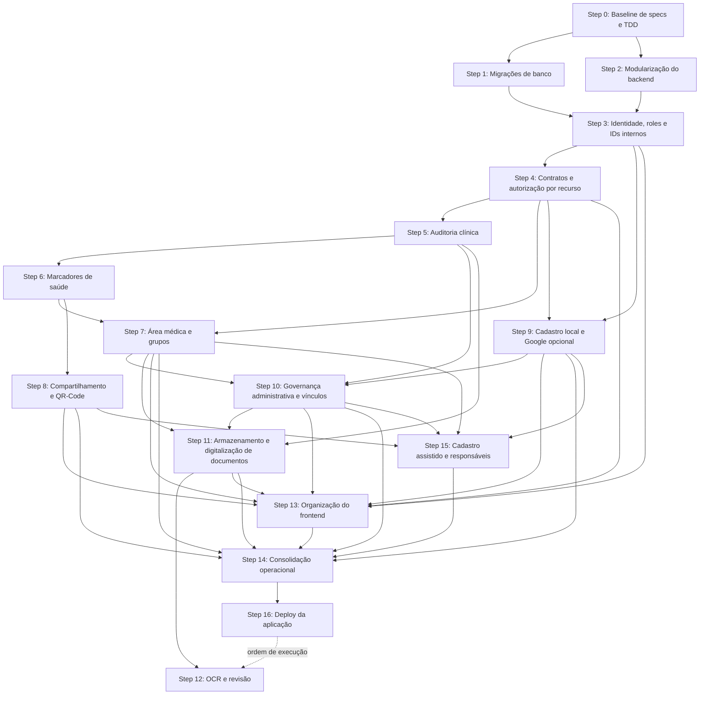

# Plano de Evolução Arquitetural

## Objetivo

Preparar o Documento Unificado de Saúde para cadastro real de pacientes,
governança administrativa sem acesso clínico, marcadores, área médica,
compartilhamento por QR-Code e documentos com OCR sem transformar o projeto em
uma arquitetura maior do que o problema atual exige.

Este documento é o tracker interno do plano. As funcionalidades somente podem
entrar em implementação depois que sua spec estiver escrita e revisada.

## Premissas

- A aplicação continuará como um monólito modular.
- O banco atual contém dados de demonstração. Se essa premissa mudar, o plano de
  migração deverá ser revisado antes do Step 1.
- SQL explícito e `mysql-connector` serão mantidos no backend enquanto atenderem
  ao projeto; Alembic e SQLAlchemy serão usados na infraestrutura de migrations.
- Não serão introduzidos microserviços, Redis, filas externas, event sourcing ou
  ORM sem uma necessidade comprovada por uma spec.
- Backend, frontend, banco e testes fazem parte da mesma entrega vertical.
- Autenticação federada comprova identidade, mas somente o backend concede role
  e escopo; `admin` permanece uma conta institucional sem acesso clínico.

## Princípios obrigatórios

### Spec-driven development

Toda mudança de comportamento começa em uma spec versionada em `docs/specs/`.
Cada spec deve conter:

- contexto e problema;
- histórias e regras de negócio;
- cenários de aceitação em Given/When/Then;
- contratos de API e dados afetados;
- requisitos de segurança e autorização;
- casos de erro e limites;
- não objetivos;
- estratégia de testes;
- dependências e critérios de conclusão.

Se a implementação revelar uma regra nova, a spec deve ser atualizada antes do
código correspondente.

### Strict TDD

O ciclo obrigatório para cada comportamento é:

1. **RED:** escrever o menor teste que expresse um cenário da spec e confirmar
   que ele falha pela razão esperada.
2. **GREEN:** implementar apenas o necessário para o teste passar.
3. **REFACTOR:** melhorar nomes, remover duplicação e ajustar responsabilidades
   mantendo toda a suíte verde.
4. Executar os testes afetados e os testes de regressão relevantes.

Código de produção não deve ser escrito antes de existir um teste falhando para
o comportamento, incluindo autorização, migrações e tratamento de erros.

### DRY

- Remover duplicação real e estável.
- Não criar abstrações para uma única ocorrência ou para uma necessidade futura
  hipotética.
- Preferir duplicação pequena e explícita a uma abstração prematura difícil de
  entender.

### Keep It Simple

- Preferir SQL, funções e módulos explícitos.
- Adicionar uma camada somente quando ela possuir responsabilidade concreta.
- Entregar a menor fatia vertical que satisfaça a spec.

### SOLID

- Cada módulo deve ter uma responsabilidade clara.
- Regras clínicas devem ser testáveis sem depender da camada HTTP.
- Dependências externas, como armazenamento e OCR, devem ficar atrás de
  contratos pequenos apenas quando houver mais de uma implementação ou quando o
  isolamento for necessário para testes.
- Não criar interfaces vazias ou hierarquias apenas para afirmar aderência ao
  SOLID.

### No overengineering

- Não implementar requisitos que não estejam em uma spec aprovada.
- Não preparar infraestrutura sem consumidor imediato.
- Toda nova dependência deve resolver um problema atual e documentado.

### Entrega vertical e coerência do frontend

- Uma entrega de backend não é considerada encerrada sem uma revisão explícita
  do impacto nos fluxos e contratos consumidos pelo frontend.
- A revisão ocorre depois que o backend está verde e antes da Definition of Done;
  seu resultado é registrado na spec ou na descrição do PR, inclusive quando a
  conclusão for "sem alteração de frontend".
- Quando houver impacto, a mesma entrega atualiza estados, contratos, testes e a
  experiência da interface antes de ser marcada como `DONE`.
- Componentes tocados não podem manter ou reproduzir padrões visuais legados.
  Devem seguir a direção visual vigente em
  `docs/specs/003-unified-identity-roles-frontend.md`, incluindo modais,
  formulários, feedback, loading, vazio e erro.
- A modernização fica limitada ao fluxo afetado; superfícies sem relação com a
  entrega permanecem no Step 13 para evitar redesign não planejado.

## Workflow de cada entrega

1. Selecionar uma tarefa desbloqueada neste plano.
2. Criar ou atualizar sua spec em `docs/specs/`.
3. Revisar a spec, contratos, riscos e não objetivos.
4. Marcar a tarefa como `SPEC APPROVED` neste documento.
5. Executar o ciclo RED, GREEN e REFACTOR em incrementos pequenos.
6. Ao concluir o backend, revisar e registrar o impacto no frontend.
7. Se houver impacto, atualizar a spec antes do comportamento correspondente e
   executar o ciclo RED, GREEN e REFACTOR do frontend.
8. Atualizar documentação e exemplos de ambiente.
9. Executar a Definition of Done.
10. Atualizar status, PR/commit e observações neste tracker.

## Status utilizados

- `PLANNED`: aguardando início.
- `SPEC WRITING`: spec em elaboração.
- `SPEC REVIEW`: aguardando revisão.
- `SPEC APPROVED`: pronta para TDD.
- `IN PROGRESS`: implementação em RED/GREEN/REFACTOR.
- `BLOCKED`: dependência ou decisão pendente registrada.
- `DONE`: Definition of Done atendida.

## Árvore de dependências

### Leitura da árvore

- Steps 1 e 2 podem ocorrer em paralelo depois do baseline.
- Identidade depende de banco evolutivo e módulos técnicos separados.
- Auditoria vem antes das features clínicas para evitar dados sem autoria.
- Área médica depende de autorização e marcadores.
- QR-Code depende do resumo clínico fornecido pelos marcadores.
- Somente pacientes possuem autocadastro, por conta local ou Google opcional;
  nenhum desses caminhos concede `doctor` ou `admin`.
- Governança administrativa depende de pacientes cadastrados, grupos existentes
  e auditoria, mas não concede ao admin acesso ao prontuário.
- O vínculo criado pelo admin permanece pendente até aceite do paciente; somente
  então o médico verificado passa a acessar o prontuário.
- Armazenamento de documentos depende da governança para entregar leitura ao
  médico vinculado sem abrir acesso administrativo.
- OCR depende primeiro do armazenamento seguro de documentos. Por decisão de
  2026-10-11, o Step 12 foi postergado e será o último a ser executado, depois
  do deploy; a aresta tracejada indica ordem de execução, não dependência
  técnica. Steps 13 e 14 deixam de aguardar o OCR, que entregará sua própria
  interface, testes e ajustes operacionais quando for implementado.
- A organização do frontend começa após identidade e contratos, mas suas telas
  são concluídas incrementalmente com cada feature.
- O Step 14 consolida o que já foi testado em cada step; testes não são adiados
  para o final.
- O deploy (Step 16) depende da consolidação operacional: health checks, CI
  completa e documentação de ambiente precisam existir antes de publicar.

## Tracker geral

| Step | Entrega | Dependências | Status | Referência |
|---|---|---|---|---|
| 0 | Baseline de specs e TDD | — | DONE | Primeiro ciclo TDD registrado na spec `001` |
| 1 | Migrações de banco | 0 | DONE | [PR #1](https://github.com/PedronSol/Documento-Unificado-De-Saude/pull/1) |
| 2 | Modularização do backend | 0 | DONE | [PR #2](https://github.com/PedronSol/Documento-Unificado-De-Saude/pull/2) |
| 3 | Identidade, roles e IDs internos | 1, 2 | DONE | [PR #3](https://github.com/PedronSol/Documento-Unificado-De-Saude/pull/3) |
| 4 | Contratos e autorização por recurso | 3 | DONE | [PR #4](https://github.com/PedronSol/Documento-Unificado-De-Saude/pull/4) |
| 5 | Auditoria clínica | 4 | DONE | `850e2ad`, `fe56d2a` |
| 6 | Marcadores de saúde | 5 | DONE | [PR #6](https://github.com/PedronSol/Documento-Unificado-De-Saude/pull/6) |
| 7 | Área médica e grupos | 4, 6 | DONE | `fc2b12e` |
| 8 | Compartilhamento e QR-Code | 6 | DONE | `333df01` |
| 9 | Cadastro local de pacientes e Google opcional | 3, 4 | DONE | `00303f3` |
| 10 | Governança administrativa e vínculos | 5, 7, 9 | DONE | [PR #10](https://github.com/PedronSol/Documento-Unificado-De-Saude/pull/10) |
| 11 | Armazenamento e digitalização de documentos | 5, 7, 10 | DONE | [PR #12](https://github.com/PedronSol/Documento-Unificado-De-Saude/pull/12) |
| 12 | OCR e revisão | 11; executado após 16 | PLANNED (postergado) | `docs/specs/021-health-document-ocr.md` |
| 13 | Organização do frontend | 3, 4, 7–11, 15 | DONE | [PR #13](https://github.com/PedronSol/Documento-Unificado-De-Saude/pull/13) |
| 14 | Consolidação operacional | 7–11, 13, 15 | PLANNED | — |
| 15 | Cadastro assistido de pacientes e responsáveis legais | 7, 8, 9, 10 | DONE | [PR #11](https://github.com/PedronSol/Documento-Unificado-De-Saude/pull/11) |
| 16 | Deploy da aplicação | 14 | PLANNED | — |

## Step 0 — Baseline de specs e TDD

**Objetivo:** estabelecer a fonte de verdade e comprovar o workflow antes de
alterar a arquitetura.

**Dependências:** nenhuma.

### Tarefas

- [x] Criar `docs/specs/README.md` com o template obrigatório de spec.
- [x] Importar e normalizar o conteúdo de `Features_DUS.txt` para specs
      versionadas no repositório.
- [x] Criar uma spec técnica para migrações de banco.
- [x] Registrar as decisões iniciais: IDs internos, papéis, preservação de dados
      e estratégia de arquivos.
- [x] Confirmar que dados atuais são descartáveis ou escrever plano de backfill.
- [x] Definir como evidenciar RED, GREEN e REFACTOR nas PRs.
- [x] Executar um ciclo TDD pequeno como prova do workflow.

### Critérios de conclusão

- Template de spec revisado.
- Features atuais versionadas dentro do repositório.
- Primeira spec marcada como aprovada.
- Workflow TDD documentado e comprovado.

## Step 1 — Migrações e ciclo de vida do banco

**Objetivo:** evoluir o schema sem apagar dados.

**Dependências:** Step 0.

### Tarefas

- [x] Executar o primeiro ciclo TDD de aplicação e registro da migration inicial.
- [x] Completar testes de aplicação única e ordenada no MySQL real.
- [x] Criar `db/migrations/` e controle de versão `alembic_version`.
- [x] Converter o schema atual na migração inicial.
- [x] Remover `DROP DATABASE` do fluxo normal.
- [x] Mover dados de demonstração para `db/seeds/development.sql`.
- [x] Adotar Alembic com SQLAlchemy restrito à infraestrutura de migrations.
- [x] Injetar configuração, engine e casos de uso no composition root.
- [x] Adicionar `make db-migrate`, `make db-seed` e `make db-reset`.
- [x] Restringir o reset ao ambiente local.
- [x] Integrar migrações ao Compose antes do backend.
- [x] Documentar criação, aplicação e rollback compensatório de migrations.

### Critérios de conclusão

- Banco vazio chega ao schema esperado.
- Segunda execução não reaplica migrations.
- Subir containers não remove dados.
- Testes de migration passam no banco real do Compose.

## Step 2 — Modularização mínima do backend

**Objetivo:** separar infraestrutura e domínios sem mudar comportamento.

**Dependências:** Step 0.

### Tarefas

- [x] Escrever testes de caracterização dos contratos atuais.
- [x] Extrair configuração para `config.py`.
- [x] Extrair conexão e transações para `database.py`.
- [x] Mover autenticação para `auth/`.
- [x] Mover pacientes e vacinas para módulos próprios.
- [x] Registrar módulos com `APIRouter`.
- [x] Remover SQL e regras de negócio de `main.py`.
- [x] Confirmar que respostas HTTP existentes não mudaram.

### Critérios de conclusão

- `main.py` apenas configura a aplicação.
- Não há abstrações genéricas sem consumidor.
- Testes de caracterização permanecem verdes.

## Step 3 — Identidade, roles e IDs internos

**Objetivo:** autenticar uma identidade `User` com uma ou mais `roles` e
refletir os contextos autorizados numa experiência de acesso testável no
frontend.

**Dependências:** Steps 1 e 2.

### Tarefas

- [x] Escrever cenários de login por `role`, `User` inativo e `role`
      incorreta.
- [x] Criar `users` e `user_roles` para `patient`, `doctor` e `admin`.
- [x] Adicionar IDs internos para `patients`.
- [x] Manter CPF obrigatório e único para todo usuário, mas removê-lo das
      chaves estrangeiras e URLs.
- [x] Criar perfil `Doctor` com CRM/UF únicos.
- [x] Migrar `sessions` para `user_id`.
- [x] Migrar relações clínicas para `patient_id`.
- [x] Criar `get_current_user` e dependências de `role`.
- [x] Atualizar seeds e contratos de autenticação com perfis demonstrativos de
      `Patient`, `Doctor` verificado, conta combinada e `Doctor` pendente.
- [x] Cobrir migração e autorização com testes.
- [x] Introduzir Vitest e React Testing Library como suíte unitária do frontend.
- [x] Melhorar o login com semântica acessível e linguagem neutra a `role`.
- [x] Exibir dashboard de paciente ou estado institucional seguro conforme o
      contexto autorizado.
- [x] Cobrir login, erros, sessão e renderização por `role` com testes
      unitários.
- [x] Preservar e ampliar os fluxos Playwright afetados.

### Critérios de conclusão

- [x] `Patient` e `Doctor` compartilham `User` e `Session`.
- [x] Sessões e URLs não dependem de CPF.
- [x] `Role` incorreta retorna `403`.
- [x] Login e home representam o contexto sem tratar o frontend como fonte de
  autorização.
- [x] Testes unitários React, Playwright, build e testes backend passam.

## Step 4 — Contratos e autorização por recurso

**Objetivo:** desacoplar autenticação do dashboard e centralizar ownership.

**Dependências:** Step 3.

### Tarefas

- [x] Escrever matriz de autorização por endpoint.
- [x] Reduzir a resposta de login ao usuário autenticado.
- [x] Fazer `/me` retornar somente identidade e perfil, sem coleções clínicas.
- [x] Manter endpoints separados para vacinas, alertas e documentos; marcadores
      permanecem reservados para o Step 6.
- [x] Reservar rotas médicas sob `/medical`.
- [x] Centralizar ownership dos recursos atuais e definir a política de acesso
      médico por vínculo; a verificação executável entra no Step 7 com seu
      primeiro consumidor.
- [x] Padronizar respostas `401`, `403`, `404`, `409` e `422`.
- [x] Criar testes contra acesso por ID manipulado.

### Critérios de conclusão

- Recursos são carregados independentemente.
- Toda consulta sensível verifica usuário, papel e ownership.
- A matriz de autorização está coberta por testes.

## Step 5 — Auditoria clínica

**Objetivo:** registrar autoria de alterações e acessos sensíveis antes das novas
features clínicas.

**Dependências:** Step 4.

### Tarefas

- [x] Escrever testes para auditoria atômica e sanitização.
- [x] Criar tabela `clinical_audit_events`.
- [x] Registrar ator, paciente, ação, recurso e data.
- [x] Suportar snapshots JSON anteriores e posteriores quando necessários.
- [x] Participar da mesma transação da mudança clínica.
- [x] Proibir senha, token e conteúdo integral de documentos nos logs.
- [x] Definir o padrão de ações para os próximos recursos sem implementá-los.
- [x] Revisar o impacto no frontend após o backend ficar verde.
- [x] Alinhar o modal de criação e edição de vacina ao padrão visual vigente.

### Critérios de conclusão

- Operação que falha não deixa auditoria inconsistente.
- Toda mudança clínica identifica responsável e momento.
- Dados secretos não aparecem na auditoria.
- O fluxo de vacina tocado não preserva padrões visuais legados.

## Step 6 — Marcadores de saúde

**Objetivo:** permitir ao paciente gerenciar condições, diagnósticos, alergias e
medicações com histórico.

**Dependências:** Step 5.

### Tarefas

- [x] Converter os cenários de marcadores em testes de aceitação.
- [x] Criar `health_markers` com tipo, nome, dados clínicos e status.
- [x] Registrar criador, atualizador e timestamps.
- [x] Impedir duplicidade ativa por paciente, tipo e nome normalizado.
- [x] Implementar criação, listagem, edição e desativação lógica.
- [x] Reutilizar a regra de maioridade.
- [x] Integrar auditoria na mesma transação.
- [x] Criar a interface do paciente seguindo os estados da spec.
- [x] Exibir ativos e histórico removido sem misturar seus estados.
- [x] Usar diálogos acessíveis para edição e confirmação de remoção.
- [x] Eliminar confirmação nativa remanescente na superfície frontend tocada.
- [x] Cobrir validação, duplicidade, ownership e desativação.

### Critérios de conclusão

- Nenhuma exclusão física apaga histórico clínico.
- Duplicidade ativa retorna `409`.
- Cenários da spec passam no backend e no Playwright.

## Step 7 — Área médica e grupos de atendimento

**Objetivo:** autorizar médicos somente sobre pacientes atribuídos.

**Dependências:** Steps 4 e 6.

### Tarefas

- [x] Escrever cenários de vínculo válido, inválido e inativo.
- [x] Criar grupos, vínculos de médicos e vínculos de pacientes.
- [x] Implementar busca de pacientes autorizados por nome ou CPF.
- [x] Criar prontuário longitudinal médico somente leitura.
- [x] Reutilizar o módulo de marcadores para alterações médicas.
- [x] Registrar usuário e CRM nas alterações.
- [x] Bloquear acesso direto a paciente de outro grupo.
- [x] Criar interface médica e testes ponta a ponta.
- [x] Alinhar a área médica ao design system institucional e documentar tokens,
      componentes e governança visual.
- [x] Exibir o seletor multirole como dock inferior flutuante em mobile,
      preservando navegação no cabeçalho em telas amplas.
- [x] Ampliar o dock para celulares/tablets e tornar a aplicação instalável
      como PWA sem persistir dados de saúde no dispositivo.

### Critérios de conclusão

- Médico vê apenas pacientes de grupos ativos compartilhados.
- Acesso não autorizado retorna `403`, inclusive por URL direta.
- Alterações aparecem no histórico com autoria médica.

## Step 8 — Compartilhamento temporário e QR-Code

**Objetivo:** compartilhar um resumo mínimo sem login, com expiração e
revogação.

**Dependências:** Step 6.

### Tarefas

- [x] Escrever testes para token válido, expirado, revogado e adulterado.
- [x] Criar `compartilhamentos` com token hash, expiração e revogação.
- [x] Armazenar somente o hash do token.
- [x] Criar endpoints autenticados para gerar e revogar.
- [x] Criar endpoint público somente leitura.
- [x] Definir explicitamente os campos permitidos no resumo.
- [x] Excluir CPF, e-mail e dados não necessários.
- [x] Auditar geração, revogação e acesso.
- [x] Gerar QR-Code e temporizador no frontend.

### Critérios de conclusão

- QR contém somente URL com token aleatório.
- Expiração e revogação têm efeito imediato.
- Nenhum dado clínico é retornado para token inválido.

## Step 9 — Cadastro de pacientes e autenticação

**Objetivo:** permitir autocadastro exclusivamente de pacientes por e-mail e
senha ou, opcionalmente, Google OIDC, mantendo roles profissionais sob
provisionamento confiável.

**Dependências:** Steps 3 e 4.

### Tarefas

- [x] Revisar e aprovar `docs/specs/006-patient-onboarding-authentication.md`.
- [x] Escrever o primeiro teste RED do cadastro local transacional.
- [x] Permitir cadastro local com e-mail normalizado, senha protegida e role
      fixa `patient`, sem criar identidade externa.
- [x] Escrever testes para token Google válido, expirado, adulterado, audience e
      issuer incorretos antes da integração.
- [x] Criar identidade externa única por `(issuer, subject)` sem usar e-mail como
      chave federada.
- [x] Permitir cadastro público somente com role fixa `patient` nos dois
      caminhos.
- [x] Coletar e validar os dados cadastrais que o provedor não fornece.
- [x] Preservar o login local existente e normalizar e-mail consistentemente.
- [x] Criar sessão HTTP-only local depois de autenticar ou concluir o cadastro.
- [x] Impedir autodeclaração de `doctor` e `admin` em qualquer payload.
- [x] Cobrir cadastro, login, conflito de CPF/e-mail e erros no frontend em
      320 px e viewport ampla.

### Critérios de conclusão

- Um paciente novo consegue criar sua conta sem intervenção no banco.
- Um paciente consegue se cadastrar, entrar e continuar usando conta local sem
  vínculo Google.
- Google é uma alternativa de autenticação, e o backend concede apenas
  `patient` em qualquer caminho público.
- `doctor` e `admin` continuam impossíveis de obter por autocadastro.
- Senha em texto puro e token do provedor nunca são persistidos; a sessão local
  não é substituída pelo token Google.

## Step 10 — Governança administrativa e vínculos de cuidado

**Objetivo:** permitir que cada admin provisione e gerencie somente seus
médicos e vínculos, sem acesso direto a qualquer informação clínica.

**Dependências:** Steps 5, 7 e 9.

### Tarefas

- [x] Concluir e aprovar `docs/specs/007-administrative-access-governance.md`.
- [x] Definir bootstrap seguro das contas administrativas, sem cadastro público.
- [x] Tornar `admin` exclusiva e impedir coexistência com `patient` ou `doctor`.
- [x] Fazer o admin emitir convite profissional de uso único; o médico pode
      autenticar sua identidade com Google, mas nunca criar o próprio cadastro.
- [x] Registrar `created_by_admin_user_id` em médicos e
      `managed_by_admin_user_id` em grupos/vínculos administrados.
- [x] Permitir que admin cadastre, corrija, verifique, suspenda e desative somente
      médicos criados por ele.
- [x] Criar diretório administrativo paginado de usuários ativos com allowlist
      exclusivamente cadastral e sem qualquer join clínico.
- [x] Permitir que o admin convide qualquer paciente ativo para um grupo sob sua
      gestão, sem alterar o cadastro do paciente.
- [x] Manter o vínculo `pending` até aceite do paciente; recusa ou revogação não
      concede acesso.
- [x] Bloquear o médico de criar o próprio vínculo ou ampliar seu grupo.
- [x] Criar auditoria administrativa separada, sem snapshots clínicos.
- [x] Criar área administrativa e caixa de convites do paciente seguindo o design
      system, com testes de ownership cruzado entre admins.

### Critérios de conclusão

- Admin não consegue abrir perfil clínico, vacina, marcador, documento ou
  qualquer outro recurso do prontuário.
- Conta administrativa não acumula role clínica.
- Admin altera somente médicos, grupos e vínculos sob sua responsabilidade.
- Identidade Google do médico somente completa convite previamente emitido pelo
  admin responsável e não concede role por conta própria.
- Consulta global retorna somente dados cadastrais mínimos de usuários ativos.
- Somente aceite do paciente ativa o acesso de médicos verificados do grupo.
- Toda concessão, correção, suspensão e revogação administrativa é auditada.

## Step 11 — Armazenamento e digitalização segura de documentos

**Objetivo:** armazenar arquivos sem acoplar binários ao banco e entregá-los
somente ao paciente proprietário ou a médico com vínculo ativo, permitindo ao
paciente adulto capturar uma página pela câmera com consentimento explícito.

**Dependências:** Steps 5, 7 e 10.

### Tarefas

- [x] Escrever testes de formato, tamanho, ownership e falha de persistência.
- [x] Definir contrato pequeno de armazenamento.
- [x] Implementar armazenamento local para desenvolvimento.
- [x] Salvar no banco somente metadados e chave do arquivo.
- [x] Usar nomes internos aleatórios.
- [x] Validar extensão, MIME real, tamanho e integridade básica.
- [x] Criar estados `uploaded`, `processing`, `needs_review`, `confirmed`,
      `failed` e `removed`.
- [x] Proteger lista e download do paciente por ownership.
- [x] Proteger lista e download médico por perfil verificado e vínculo ativo.
- [x] Negar explicitamente todo acesso administrativo a metadados e binários.
- [x] Implementar remoção lógica e limpeza física controlada.
- [x] Auditar upload, download, remoção e listagem médica.
- [x] Implementar digitalização de uma página pela câmera, com prévia, refazer,
      fallback para arquivo e encerramento seguro do stream.
- [x] Solicitar câmera somente após gesto explícito, sem áudio, sem persistência
      local da captura e limitada ao próprio origin.

### Critérios de conclusão

- Arquivos não são públicos nem previsíveis.
- Binários não são armazenados no MySQL.
- Paciente não acessa documento alheio.
- Médico acessa somente documentos de paciente com vínculo ativo.
- Admin da aplicação não acessa metadados nem conteúdo clínico.
- Câmera não inicia sem consentimento, é liberada ao sair do fluxo e sua recusa
  não impede o upload tradicional.

## Step 12 — OCR e revisão manual

**Objetivo:** processar documentos de modo assíncrono e confirmar dados antes de
inseri-los no histórico.

**Dependências:** Step 11.

**Ordem de execução:** postergado em 2026-10-11; será o último step executado,
depois do Step 16. Ao ser retomado, a spec `021` deve revisar o impacto no
frontend organizado pelo Step 13, na CI do Step 14 e no ambiente publicado pelo
Step 16 (por exemplo, dependências do engine OCR na imagem do backend).

### Tarefas

- [ ] Escrever testes usando um OCR fake antes da integração real.
- [ ] Criar tabela `ocr_jobs`.
- [ ] Criar worker simples baseado no banco, sem Redis inicialmente.
- [ ] Tornar o processamento idempotente.
- [ ] Salvar texto, campos, confiança e erros.
- [ ] Marcar baixa confiança para revisão obrigatória.
- [ ] Criar endpoint de acompanhamento do processamento.
- [ ] Criar endpoints de correção e confirmação.
- [ ] Vincular biomarcadores ao documento somente após confirmação.
- [ ] Preservar documento original quando o OCR falhar.
- [ ] Criar interface de revisão e testes ponta a ponta.

### Critérios de conclusão

- Upload HTTP não aguarda OCR.
- Reprocessamento não duplica biomarcadores.
- Dados somente entram no histórico após confirmação.

## Step 13 — Organização incremental do frontend

**Objetivo:** separar navegação e estado por papel e feature.

**Dependências:** Steps 3 e 4; conclusão acompanha Steps 7 a 11 e 15. A
interface de revisão do OCR fica com o Step 12.

### Tarefas

- [x] Escrever testes de navegação e papel antes de reorganizar rotas.
- [x] Criar áreas `patient`, `medical`, `admin` e `share`.
- [x] Separar componentes por feature.
- [x] Manter `apiFetch` como cliente HTTP central.
- [x] Criar hooks somente quando houver lógica reutilizada.
- [x] Padronizar tratamento de `401`, `403`, `409` e `422`.
- [x] Redirecionar o login conforme papel.
- [x] Remover mocks conforme cada integração real entrar.
- [x] Substituir padrões visuais legados nos fluxos tocados por cada entrega,
      incluindo modais e formulários.
- [x] Não introduzir Redux enquanto estado local e hooks forem suficientes;
      Zustand entrou somente para a sessão compartilhada entre rotas (spec `037`).
- [x] Listar dependentes e identificar o contexto de menor com tom alaranjado
      tokenizado e texto explícito.
- [x] Modularizar o CSS em `frontend/styles/` preservando a cascata.

### Critérios de conclusão

- Nenhuma página central concentra todas as features.
- Papel controla navegação, mas segurança permanece no backend.
- Cada feature possui loading, vazio, erro e confirmação testados.

## Step 14 — Consolidação operacional

**Objetivo:** consolidar integrações, saúde da aplicação e pipeline final.

**Dependências:** Steps 7 a 11, 13 e 15. O OCR (Step 12) traz seus próprios
ajustes operacionais quando for executado.

### Tarefas

- [ ] Executar migrations em um banco de integração limpo na CI.
- [ ] Consolidar matriz completa de autorização.
- [ ] Criar `/health/live` e `/health/ready`.
- [ ] Adicionar healthcheck do backend ao Compose.
- [ ] Adicionar identificador de requisição aos logs.
- [ ] Revisar logs para ausência de dados sensíveis.
- [ ] Executar testes unitários, integração, build e Playwright na CI.
- [ ] Validar recuperação de banco e arquivos no ambiente definido.
- [ ] Revisar documentação operacional e variáveis de ambiente.

### Critérios de conclusão

- CI valida migrations, backend, frontend e fluxos ponta a ponta.
- Compose distingue processo vivo de aplicação pronta.
- Logs permitem diagnóstico sem vazar dados clínicos.

## Step 15 — Cadastro assistido de pacientes e responsáveis legais

**Objetivo:** permitir que o médico adicione pacientes à própria lista por
vínculo direto com consentimento, cadastre pacientes provisórios adultos ou
menores e entregue o prontuário ao titular ou a um responsável legal, sem
alterar os grupos geridos por admin.

**Dependências:** Steps 7, 8, 9 e 10.

### Tarefas

- [x] Revisar e aprovar `docs/specs/036-doctor-assisted-patient-registration.md`.
- [x] 15.1: vínculo direto, autorização médica por grupo ou vínculo e
      solicitação a paciente cadastrado com aceite.
- [x] 15.2: paciente provisório adulto, correção pelo médico autor e
      reivindicação por link/QR com e-mail/senha ou Google.
- [x] 15.3: guarda, provisório menor com responsável, contexto do dependente
      (`X-Acting-Patient`) e marcadores de menor pelo médico.
- [x] 15.4: transferência a pedido, desvínculo pelo dependente adulto e
      guarda de menor titular de conta.
- [x] Auditar todas as ações na auditoria clínica do paciente afetado.
- [x] Cobrir médico, reivindicação, responsável e paciente em 320 px e
      viewport ampla.

### Critérios de conclusão

- Médico nunca acessa prontuário de paciente com conta sem aceite.
- Conta provisória só é assumida com token e dados confirmados.
- Todo menor provisório tem responsável, e só guarda ativa age por ele.
- A maioridade não altera a guarda; o dependente adulto assume a conta e
  desvincula o responsável quando pedir.
- Grupos geridos por admin continuam fora do alcance do médico.

## Step 16 — Deploy da aplicação

**Objetivo:** publicar frontend, backend, banco e armazenamento de documentos em
um ambiente acessível por HTTPS, de forma reproduzível, segura e sem dados de
demonstração.

**Dependências:** Step 14.

### Tarefas

- [ ] Escrever e aprovar a spec `docs/specs/050-application-deployment.md`,
      incluindo a escolha da plataforma de hospedagem e seus custos.
- [ ] Definir ambientes (homologação e/ou produção) e quais branches publicam
      em cada um.
- [ ] Preparar imagens de produção: frontend com `next build`/`next start`,
      backend sem reload e processos sem root.
- [ ] Fornecer configuração e segredos somente por variáveis de ambiente ou
      cofre da plataforma; nada sensível versionado.
- [ ] Garantir `APP_ENV=production`: seeds, reset e dados demonstrativos
      bloqueados.
- [ ] Exigir HTTPS, `COOKIE_SECURE=true`, CORS e `PUBLIC_APP_URL` restritos ao
      domínio publicado; câmera do Step 11 depende de contexto seguro.
- [ ] Executar migrations forward-only como etapa do deploy, antes da nova
      versão do backend receber tráfego.
- [ ] Provisionar MySQL persistente e armazenamento privado de documentos fora
      de diretório público, ambos com backup.
- [ ] Liberar tráfego somente após `/health/ready` do Step 14.
- [ ] Automatizar o deploy a partir da CI verde e documentar o rollback.
- [ ] Executar smoke test pós-deploy (login, dashboard e download de documento).

### Critérios de conclusão

- Aplicação acessível por HTTPS no ambiente definido.
- Deploy reproduzível pelo pipeline, sem passos manuais não documentados.
- Nenhum segredo ou dado clínico real no repositório, logs ou imagens.
- Banco e documentos persistem entre deploys e possuem backup testado.
- Rollback documentado e exercitado ao menos uma vez.

## Definition of Ready

Uma tarefa só pode entrar em implementação quando:

- [ ] sua dependência está `DONE` ou existe um acordo explícito de paralelismo;
- [ ] a spec está versionada e em `SPEC APPROVED`;
- [ ] critérios de aceitação e não objetivos estão claros;
- [ ] contratos de API e dados afetados foram identificados;
- [ ] fluxos do frontend potencialmente afetados foram identificados, ou a spec
      registrou por que não existe superfície de interface relacionada;
- [ ] riscos de segurança e autorização foram avaliados;
- [ ] o primeiro teste RED foi identificado.

## Definition of Done

Uma tarefa só pode ser marcada como `DONE` quando:

- [ ] cenários da spec possuem testes;
- [ ] há evidência do ciclo RED, GREEN e REFACTOR;
- [ ] testes unitários e de integração afetados passam;
- [ ] build relevante passa;
- [ ] a revisão de impacto no frontend foi registrada após o backend ficar verde;
- [ ] quando um fluxo de interface foi afetado, contratos, estados, testes e
      padrão visual vigente foram atualizados na mesma entrega;
- [ ] nenhum padrão visual legado foi mantido ou introduzido nos componentes
      tocados;
- [ ] autorização possui casos positivos e negativos;
- [ ] migrations foram testadas em banco limpo quando aplicável;
- [ ] documentação e exemplos de ambiente foram atualizados;
- [ ] `git diff --check` passa;
- [ ] não existem artefatos gerados versionados;
- [ ] o tracker contém status e referência do commit ou PR;
- [ ] nenhuma implementação fora da spec foi adicionada.

## Decisões pendentes para revisão

| Decisão | Recomendação inicial | Status |
|---|---|---|
| Identificador interno | `BIGINT AUTO_INCREMENT`; CPF permanece único | APROVADA |
| Dados existentes | Dados atuais são demonstrativos e recriáveis | APROVADA |
| Migrações | Alembic; SQLAlchemy somente na infraestrutura | APROVADA |
| Roles | `patient`+`doctor` permitidas; `admin` exclusiva e concedida pelo servidor | APROVADA |
| Autocadastro | Somente paciente; conta local ou Google opcional; role fixa no backend | APROVADA |
| Provisionamento profissional | Médico cadastrado por admin responsável; sem autocadastro | APROVADA |
| Ownership administrativo | Admin altera somente médicos, grupos e vínculos sob sua gestão | APROVADA |
| Sigilo clínico | Admin consulta diretório cadastral mínimo, nunca prontuário | APROVADA |
| Ativação do vínculo | Convite administrativo exige aceite do paciente | APROVADA |
| Arquivos | Local em desenvolvimento; contrato compatível com S3 | APROVADA |
| OCR | Worker com jobs no MySQL, sem Redis inicialmente | APROVADA |
| Arquitetura | Monólito modular | APROVADA |
| Plataforma de deploy | Definir na spec `050` considerando custo, HTTPS, MySQL gerenciado e volume privado | PENDENTE |
| Impacto no frontend | Revisão obrigatória após o backend; fluxo tocado segue o padrão visual vigente | APROVADA |

## Registro de evolução

| Data | Step | Mudança de status | Referência | Observação |
|---|---|---|---|---|
| 2026-10-01 | 0 | PLANNED → SPEC REVIEW | `docs/specs/000` a `040` | Features importadas, decisões propostas e spec de migrations prontas para revisão. |
| 2026-10-01 | 0 | SPEC REVIEW → IN PROGRESS | Specs `000` e `001` | Fundação e migrations aprovadas; primeiro ciclo TDD é a próxima atividade. |
| 2026-10-01 | 0 | IN PROGRESS → DONE | `backend/__tests__/test_migrations.py` | RED, GREEN e REFACTOR comprovados; 11 testes do backend passaram. |
| 2026-10-01 | 1 | PLANNED → IN PROGRESS | Experimento local não versionado | Primeiro runner próprio criado por TDD; posteriormente removido em favor do Alembic. |
| 2026-10-02 | 1 | IN PROGRESS | Experimento local não versionado | Runner próprio chegou a 24 testes verdes; evidência preservada apenas como histórico da decisão. |
| 2026-10-02 | 1 | DECISÃO REVISADA | Specs `000` e `001` | Executor próprio substituído por Alembic; DI aplicada a configuração e conexões. |
| 2026-10-02 | 1 | IN PROGRESS | Alembic `0001`, composition root e testes | Runner próprio removido; 21 testes passaram e 1 integração foi ignorada porque o Docker Desktop não está ativo. |
| 2026-10-02 | 1 | IN PROGRESS → DONE | [PR #1](https://github.com/PedronSol/Documento-Unificado-De-Saude/pull/1) | Testes automatizados passaram no MySQL 8 real via Docker; idempotência, preservação de dados, falha ordenada, volume persistente e inicialização do backend foram validados. |
| 2026-10-05 | 4 | PLANNED → SPEC REVIEW | `docs/specs/004-resource-contracts-authorization.md` | Matriz e contratos propostos; implementação aguarda revisão. O verificador de vínculo médico foi alinhado ao Step 7, onde terá dados e consumidor concretos. |
| 2026-10-05 | 4 | SPEC REVIEW → SPEC APPROVED | `docs/specs/004-resource-contracts-authorization.md` | Contratos, matriz, erros e fronteira com o Step 7 aprovados; próximo passo é o primeiro teste RED. |
| 2026-10-05 | 4 | SPEC APPROVED → IN PROGRESS | `backend/__tests__/test_identity_api.py` | Primeiro RED confirmou que o login ainda retornava o dashboard; implementação iniciou após a falha esperada. |
| 2026-10-05 | 4 | IN PROGRESS → DONE | `ec4c614`, `96a3360` | Contratos separados e autorização por ownership implementados; backend com 63 testes aprovados, frontend com 12 testes unitários e 11 E2E aprovados, e build Webpack concluído. |
| 2026-10-06 | 5 | PLANNED → SPEC REVIEW | `docs/specs/005-clinical-audit.md` | Proposta de auditoria append-only e atômica aplicada às mutações de vacina; implementação aguarda revisão. |
| 2026-10-06 | Todos | DECISÃO APROVADA | Definition of Ready/Done | Toda entrega passa a registrar impacto no frontend após o backend verde; componentes tocados devem abandonar padrões visuais legados. |
| 2026-10-06 | 5 | SPEC REVIEW → SPEC APPROVED | `docs/specs/005-clinical-audit.md` | Auditoria transacional, fronteiras de autorização e alinhamento do modal de vacina aprovados; próximo passo é a migration `0003` em RED. |
| 2026-10-06 | 5 | SPEC APPROVED → IN PROGRESS | branch `feat/clinical-audit` | Auditoria atômica das mutações de vacina, migration `0003` e modal atualizado foram implementados por TDD. |
| 2026-10-06 | 5 | IN PROGRESS → DONE | `850e2ad`, `fe56d2a` | Backend: 75 testes; frontend: 13 unitários e 12 E2E; migration e atomicidade aprovadas no MySQL 8 real; build aprovado. |
| 2026-10-06 | 6 | PLANNED → SPEC REVIEW | `docs/specs/010-health-markers.md` | Dependências, contratos, histórico, unicidade concorrente, auditoria e impacto no frontend revisados; implementação aguarda aprovação. |
| 2026-10-06 | 6 | SPEC REVIEW → SPEC APPROVED | `docs/specs/010-health-markers.md` | Contratos, normalização, histórico removido, auditoria e direção do frontend aprovados; próximo passo é a migration `0004` em RED. |
| 2026-10-06 | 6 | SPEC APPROVED → IN PROGRESS | branch `feat/health-markers` | Migration `0004`, API, auditoria e interface foram concluídas por TDD; 88 testes backend, 18 unitários frontend, 13 E2E e build passaram. Aguarda commits e referência do PR para `DONE`. |
| 2026-10-06 | 6 | IN PROGRESS → DONE | [PR #6](https://github.com/PedronSol/Documento-Unificado-De-Saude/pull/6) | Entrega publicada com migration, autorização, auditoria, interface alinhada e evidências de regressão registradas. |
| 2026-10-08 | 7 | PLANNED → SPEC REVIEW | `docs/specs/030-medical-panel.md` | Cenários, contratos, grupos, matriz de vínculo, segurança, prontuário mínimo e impacto no frontend detalhados; implementação aguarda aprovação. |
| 2026-10-08 | 7 | SPEC REVIEW → SPEC APPROVED | `docs/specs/030-medical-panel.md` | Grupos, vigência, busca, prontuário mínimo, autoria médica, erros e direção do frontend aprovados; próximo passo é a migration `0005` em RED. |
| 2026-10-08 | 7 | SPEC APPROVED → IN PROGRESS | branch `feat/medical-panel` | Migration `0005`, autorização por grupos, prontuário auditado, mutações médicas e interface profissional implementados por TDD; validação final e referência de commit pendentes. |
| 2026-10-08 | 7 | CORREÇÃO VISUAL → SPEC APPROVED | `docs/specs/031-interface-design-system.md` | Alinhamento da área médica e design system solicitados e aprovados; tokens, guia e guardrail visual serão implementados sem alterar contratos funcionais. |
| 2026-10-08 | 7 | CORREÇÃO VISUAL → IMPLEMENTED | `9ac89b6` | Tokens claro/escuro, guia, governança no `AGENTS.md`, área médica mobile-first, diálogos azuis e `ClinicalSelect` acessível concluídos; RED/GREEN e validação em 320 px registrados. |
| 2026-10-08 | 7 | DOCK MOBILE → IMPLEMENTED | `fa92262`, `84cd842`, [PR #7](https://github.com/PedronSol/Documento-Unificado-De-Saude/pull/7) | Seletor multirole virou dock flutuante mobile-first, com safe area, espaço de conteúdo e retorno ao cabeçalho a partir de 800 px; captura reportada reproduzida em RED a 768 px; 27 unitários, 14 E2E e build aprovados. |
| 2026-10-08 | 7 | PWA MOBILE → IMPLEMENTED | `d29389f`, `427138d`, [PR #7](https://github.com/PedronSol/Documento-Unificado-De-Saude/pull/7) | Dock permanece em celular/tablet e em dispositivos touch mesmo com viewport CSS amplo; manifest instalável, ícones, registro do service worker e fallback sem dados sensíveis concluídos por TDD. A emulação touch em 1366 px e viewport de 475 px confirma o dock; 27 testes unitários, 16 E2E e build aprovados após o ajuste. |
| 2026-10-08 | 7 | DOCK FIXED → IMPLEMENTED | `docs/specs/033-mobile-pwa.md` | Corrigido o containing block: dock agora é sibling do header sticky; testes validam geometria próxima ao limite inferior do viewport, não só `position: fixed`. Chrome emulado 475×900 confirmou bottom a 12 px; 27 unitários, 16 E2E e build passaram. Commit `6057170`, PR #7. |
| 2026-10-08 | 7 | MENU DA CONTA MOBILE → DONE | `docs/specs/034-mobile-account-menu.md`, [PR #7](https://github.com/PedronSol/Documento-Unificado-De-Saude/pull/7) | Menu acessível com nome/e-mail, configurações e logout; avatar preserva foto/iniciais. `/settings` abre a partir do menu; E2E confirma contenção a 320 px. Suíte frontend, 17 E2E e build aprovados. |
| 2026-10-08 | 7 | PERFIL PRÓPRIO → DONE | `docs/specs/035-self-service-profile.md`, [PR #7](https://github.com/PedronSol/Documento-Unificado-De-Saude/pull/7) | API `PATCH /me/profile` autoescopada e transacional; atualiza display/preferred name, rejeita campos protegidos e payload inválido. CORS libera PATCH somente às origens configuradas. 105 testes backend (6 integração ignorados), 28 unitários, 17 E2E e build aprovados. Lint indisponível: `eslint` não instalado. |
| 2026-10-08 | 7 | RETORNO DE CONFIGURAÇÕES → DONE | `docs/specs/035-self-service-profile.md`, [PR #7](https://github.com/PedronSol/Documento-Unificado-De-Saude/pull/7) | Link “Voltar ao início” agora reaproveita a affordance `.medical-back`, com seta e tipografia compacta; RED/GREEN, Playwright mobile e build aprovados. |
| 2026-10-08 | 7 | LARGURA DESKTOP DO PACIENTE → DONE | `docs/specs/031-interface-design-system.md`, [PR #7](https://github.com/PedronSol/Documento-Unificado-De-Saude/pull/7) | `.patient-main` compartilha `--ds-layout-content` (78 rem) com a área profissional; a 1920 px fica centralizada com 1248 px, preservando fluidez em 320 px. Evidência RED/GREEN, 28 unitários, 17 E2E e build registrados. |
| 2026-10-08 | 7 | CORES DOS MARCADORES → DONE | `docs/specs/031-interface-design-system.md`, [PR #7](https://github.com/PedronSol/Documento-Unificado-De-Saude/pull/7) | Filtro ativo, contador, foco, decoração do card e estado vazio usam tokens azuis/neutros; verde permanece somente em estados positivos. RED/GREEN, 29 unitários, 17 E2E com cores computadas e build aprovados. |
| 2026-10-08 | 7 | BUSCA REATIVA DE PACIENTES → DONE | `docs/specs/030-medical-panel.md`, [PR #7](https://github.com/PedronSol/Documento-Unificado-De-Saude/pull/7) | Debounce de 300 ms, critérios de busca, CPF completo, limpeza, botão sem duplicação e descarte de respostas obsoletas implementados por TDD; 33 unitários, 17 E2E e build aprovados. |
| 2026-10-08 | 7 | IN PROGRESS → DONE | `fc2b12e` | Backend com 103 testes no MySQL 8 real, frontend com 21 unitários e 13 E2E, build aprovado; grupos, autorização, auditoria, autoria CRM e interface responsiva concluídos. |
| 2026-10-09 | 8 | SPEC APPROVED → DONE | `333df01` | Compartilhamento temporário com token entregue uma vez, revogação, allowlist pública, auditoria e interface QR concluído por strict TDD; 128 testes backend no MySQL 8, 41 unitários, 19 E2E e build aprovados. |
| 2026-10-10 | 11 (anteriormente 9) | PLANNED → SPEC REVIEW | `docs/specs/020-secure-document-storage.md` | Armazenamento foi separado do OCR; contratos, validação, atomicidade, ownership, auditoria, limpeza física e impacto no frontend foram detalhados. Implementação aguarda dependências e aprovação. |
| 2026-10-10 | Roadmap | REPLANEJADO | D009 e Steps 9–14 | Cadastro real, provisionamento profissional, ownership administrativo e consentimento estavam ausentes; duas entregas foram inseridas antes de documentos e os steps posteriores foram renumerados. |
| 2026-10-10 | 9 | PLANNED → SPEC REVIEW | `docs/specs/006-patient-onboarding-authentication.md` | Autocadastro exclusivo de pacientes, sessão local e bloqueio de elevação de role detalhados; implementação aguarda aprovação. |
| 2026-10-10 | 9 | SPEC REVIEW REAVALIADA | `docs/specs/006-patient-onboarding-authentication.md` | Cadastro local por e-mail e senha tornou-se uma alternativa completa ao Google OIDC; Google passou a ser opcional e não é necessário para usar a plataforma. |
| 2026-10-10 | 9 | SPEC REVIEW → SPEC APPROVED | `docs/specs/006-patient-onboarding-authentication.md` | Cadastro local e Google opcional aprovados para implementação; primeiro ciclo TDD começa pelo endpoint local transacional. |
| 2026-10-10 | 9 | SPEC APPROVED → IN PROGRESS | testes backend/frontend do Step 9 | Cadastro local, Google opcional, vinculação explícita, migration `0007` e interface `/register` implementados por ciclos RED/GREEN; validação final e referência de commit pendentes. |
| 2026-10-10 | 10 | PLANNED → SPEC WRITING | `docs/specs/007-administrative-access-governance.md` | Ownership por admin, diretório cadastral mínimo, convite com aceite e auditoria administrativa registrados para revisão posterior ao Step 9. |
| 2026-10-10 | 11 | SPEC REVIEW REAVALIADA | `docs/specs/020-secure-document-storage.md` | Acesso de leitura do médico vinculado e negação absoluta à role admin incorporados; migration prevista passou de `0007` para `0009`. |
| 2026-10-11 | 11 | SPEC REVIEW REAVALIADA | `docs/specs/020-secure-document-storage.md` | Digitalização de uma página pela câmera foi incorporada ao upload existente, com consentimento explícito, prévia, descarte local, fallback e testes de privacidade; implementação continua aguardando aprovação. |
| 2026-10-11 | 11 | SPEC REVIEW → SPEC APPROVED | `docs/specs/020-secure-document-storage.md` | Armazenamento, autorização, digitalização de página única, privacidade da câmera, fallback e estratégia TDD aprovados; próximo passo é confirmar o primeiro teste RED. |
| 2026-10-11 | 11 | AJUSTE DOCUMENTAL | `docs/specs/020-secure-document-storage.md` | Migration prevista renumerada de `0009` para `0013` após a inclusão das migrations de vínculos diretos, cadastro assistido, guarda e transferência; contratos aprovados permanecem inalterados. |
| 2026-10-11 | 11 | SPEC APPROVED → IN PROGRESS | testes backend/frontend do Step 11 | Armazenamento privado, upload e download auditados, remoção lógica, leitura médica e digitalização por câmera foram implementados em ciclos RED/GREEN; validação final e referência de commit ou PR permanecem pendentes. |
| 2026-10-11 | 11 | IN PROGRESS → DONE | `e1a8d86` | Validação final: pytest (243 passed com MySQL 8 real), Vitest (104), Playwright (33, incluindo digitalização em 320 px e 1280 px) e build; spec 020 marcada como implementada. |
| 2026-10-11 | 11 (complemento) | SPEC WRITING → SPEC REVIEW | `docs/specs/008-persistent-session.md` | Sessão com 24 h de inatividade e teto de 7 dias, redirecionamento de `/` com sessão válida e login lembrado pedindo somente a senha; entra no PR #12 após aprovação. |
| 2026-10-11 | 11 (complemento) | SPEC APPROVED → IMPLEMENTED | [PR #12](https://github.com/PedronSol/Documento-Unificado-De-Saude/pull/12) | Sessão com 24 h de inatividade e teto de 7 dias, redirecionamento de `/` e login lembrado implementados em três ciclos RED/GREEN; migration `0014`. |
| 2026-10-11 | 12, 13, 14, 16 | REPLANEJAMENTO | `docs/architecture-evolution-plan.md` | Step 12 (OCR) postergado para o fim da fila; Steps 13 e 14 deixam de depender dele. Criado o Step 16 (deploy), dependente do Step 14. Próxima entrega: Step 13. |
| 2026-10-11 | 13 | PLANNED → SPEC REVIEW | `docs/specs/037-frontend-organization.md` | Rotas por área, shell autenticado com identidade única, divisão por feature, tabela única de erros e remoção de legado propostas; implementação aguarda revisão. |
| 2026-10-11 | 13 | SPEC REVIEW → SPEC APPROVED | `docs/specs/037-frontend-organization.md` | Redirect para área padrão, prontuário por URL, dependentes como sub-rota com lista e tom alaranjado para menor, abas sem sub-rota, CSS modular e Zustand para sessão aprovados; próximo passo é o RED de `resolveDefaultArea`. |
| 2026-10-11 | 13 | SPEC APPROVED → DONE | `a801598`, `3fe4464`, `a85d143`, `6a9f5e1` | Áreas por URL com redirect por papel, store Zustand em memória, lista de dependentes com tom de menor, tabela única de erros, dashboards divididos por feature com prontuário em `/medical/patients/[patientId]`, CSS modular pixel-idêntico e legado removido; 239 unitários, 41 E2E e build aprovados. PR pendente. |
| 2026-10-11 | 11 (complemento) | PLANNED → SPEC REVIEW | `docs/specs/022-medical-document-upload.md` | Médico autorizado passa a enviar documentos ao paciente e remover somente os que enviou; autoria persistida pela migration `0015`. Implementação aguarda revisão. |
| 2026-10-11 | 11 (complemento) | SPEC REVIEW → SPEC APPROVED | `docs/specs/022-medical-document-upload.md` | Paciente pode remover documento médico com confirmação reforçada; `403` explicativo ao médico; envio a menor e provisório permitido. Próximo passo: RED da migration `0015`. |
| 2026-10-11 | 11 (complemento) | SPEC APPROVED → IMPLEMENTED | `1f4dc10` e `8c8b7f7` (branch `feat/medical-document-upload`) | Médico autorizado envia documentos e remove só os próprios; migration `0015` registra autor e papel; paciente remove documento médico somente após confirmação marcada. 275 testes backend (MySQL real), 248 unitários, 45 E2E e build aprovados. |
| 2026-10-11 | 13 (complemento) | PLANNED → SPEC REVIEW | `docs/specs/038-list-pagination.md` | Todas as listagens paginadas no servidor com 10/20/50/100 itens (padrão 20), filtros na requisição e `Carregar mais`; implementação aguarda revisão. |
| 2026-10-11 | 13 (complemento) | SPEC REVIEW → SPEC APPROVED | `docs/specs/038-list-pagination.md` | Rolagem infinita com busca e filtros no servidor, total na resposta, 10/20/50/100 itens; prontuário e dependentes sem paginação; resumo público em abas. |
| 2026-10-11 | 13 (complemento) | SPEC APPROVED → IMPLEMENTED | `ec81e1e`, `071bb57`, `05b8a63`, `98f9662` e fechamento (branch `feat/medical-document-upload`) | Todas as listagens paginadas e pesquisáveis no servidor (10/20/50/100, total, filtros), rolagem infinita acessível, resumo público em abas; prontuário e dependentes mantidos sem paginação. 287 unitários, 47 E2E, build e backend com MySQL real aprovados. |
| 2026-10-11 | 13 e 11 (complementos) | PR ABERTO | [PR #13](https://github.com/PedronSol/Documento-Unificado-De-Saude/pull/13) | Specs `037`, `022` e `038` entregues contra `develop`. |
| 2026-10-12 | 9, 6 e 7 (complementos) | PLANNED → SPEC REVIEW | `docs/specs/042-usability-feedback-registration-summary.md` (branch `fix/usability-feedback-registration-summary`) | Feedback de usabilidade: campos obrigatórios com `*`, visualização e confirmação de senha, máscara de CPF, novo texto dos marcadores e tipo sanguíneo informado pelo paciente adulto ou pelo responsável legal, ou registrado pelo médico vinculado (registro médico prevalece), com origem visível e (i) explicativo; implementação aguarda revisão. |
| 2026-10-12 | 9, 6 e 7 (complementos) | SPEC REVIEW → SPEC APPROVED | `docs/specs/042-usability-feedback-registration-summary.md` | Revisão aprovada: responsável legal também informa o tipo sanguíneo (origem `guardian`), edição permitida como correção rara, registro médico prevalece; spec `035` revisada. |
| 2026-10-12 | 9, 6 e 7 (complementos) | SPEC APPROVED → IMPLEMENTED | `d2a1cee`, `22e6511` e `8c8b7f7` (branch `fix/usability-feedback-registration-summary`) | Campos obrigatórios, máscara de CPF, visualização/confirmação de senha, novo texto dos marcadores e tipo sanguíneo por paciente, responsável ou médico (migration `0016`, `PUT /me/blood-type` e `PUT /medical/patients/{id}/blood-type`, auditoria). 329 testes backend (MySQL real), 325 unitários, 49 E2E e build aprovados. |
| 2026-10-12 | 9 (complemento) | REVISÃO IMPLEMENTADA | `docs/specs/042-usability-feedback-registration-summary.md`, regra 8a, `47c0529` | Senha mínima de paciente (cadastro e ativação) reduzida de 12 para 8; admin institucional mantém 12; spec `006` atualizada. 332 testes backend (MySQL real), 325 unitários, E2E afetados e build aprovados. |
| 2026-10-12 | 9, 6 e 7 (complementos) | PR ABERTO | [PR #14](https://github.com/PedronSol/Documento-Unificado-De-Saude/pull/14) | Spec `042` (cadastro, marcadores, tipo sanguíneo e senha mínima de 8) entregue contra `develop`. |
| 2026-10-12 | 9, 6 e 7 (complementos) | REVISÃO IMPLEMENTADA | `docs/specs/042-usability-feedback-registration-summary.md`, regra 14, `1b07ecf` | Tipo sanguíneo passa a ser editável por paciente/responsável e médico sem precedência (última alteração vale; origem e auditoria rastreiam); `409` por origem `doctor` removido. 332 testes backend (MySQL real), 325 unitários, E2E afetados e build aprovados. |
| 2026-10-12 | 9 (complemento) | REVISÃO IMPLEMENTADA | `docs/specs/042-usability-feedback-registration-summary.md`, regra 8b, `c24faea` | Máscara de CPF aplicada ao CPF do paciente e do responsável no vínculo direto do médico. 326 unitários, E2E de vínculo direto e build aprovados. |
| 2026-10-12 | 13 (complemento) | REVISÃO IMPLEMENTADA | `docs/specs/037-frontend-organization.md`, regra 9g, `e30663a` | Em `/patient/dependents` o seletor de contexto nomeia o contexto `Meus dependentes` e a lista oferece `Voltar para minha saúde`. 327 unitários, E2E em 320 px e 1440 px e build aprovados. |
| 2026-10-12 | 9 e 13 (complementos) | PR ABERTO | [PR #15](https://github.com/PedronSol/Documento-Unificado-De-Saude/pull/15) | Máscara de CPF no vínculo direto (spec `042`, regra 8b) e navegação da lista de dependentes (spec `037`, regra 9g) entregues contra `develop`. |
